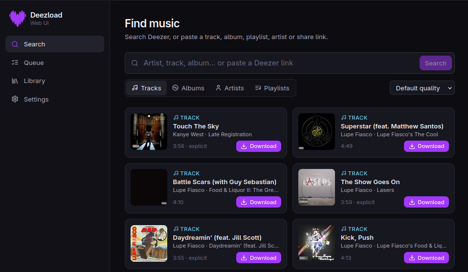
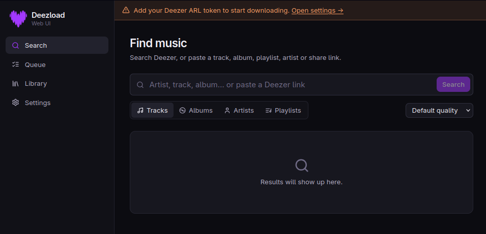
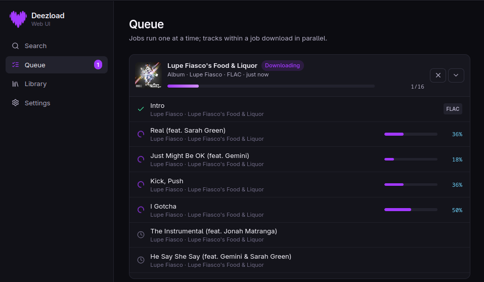
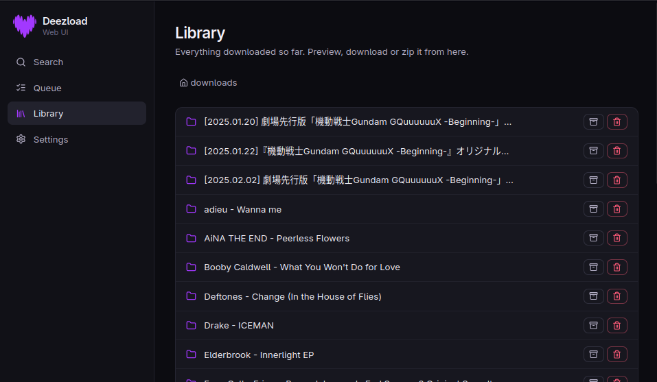
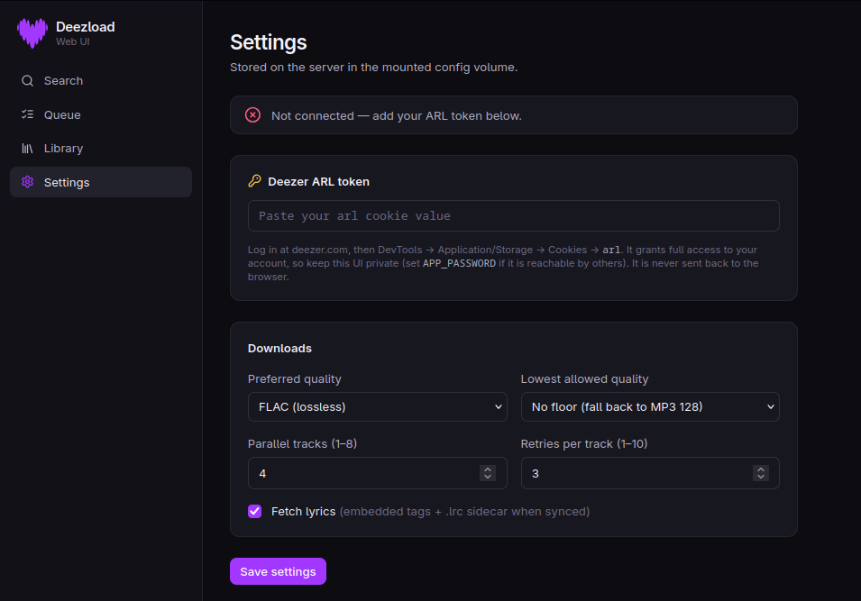

<h1 align="center">Deezload Web</h1>
<p align="center"><strong>A modern, self-hosted web UI for the Deezload Deezer downloader.</strong></p>

<p align="center">
  
  
  
  
  
</p>

<p align="center">
Search Deezer, queue tracks, albums, playlists and full artist discographies, watch live per-track progress, then browse, play and zip your library — all from the browser, deployed with one <code>docker compose up</code>.
</p>

<p align="center">
  
</p>

> 📸 **Screenshot placeholder:** `docs/screenshots/hero.png` — a wide shot of the Search page with a few results.

---

## ✨ Features

**🎯 Finding & queuing**
- **Search Deezer directly** — tracks, albums, artists and playlists, with cover art, artist, track count and duration
- **Paste any Deezer link** — tracks, albums, playlists, artists and share/redirect links (`deezer.page.link`, `link.deezer.com`) are resolved automatically
- **Per-download quality override** — pick FLAC, MP3 320 or MP3 128 right from the search page, or use your default

**📥 Queue & progress**
- **Live progress** — overall job progress plus a progress bar for every track currently downloading
- **Expandable track list** — see each track's status, resulting format (FLAC/MP3) and any error
- **Quality-fallback badge** — a track that was requested as FLAC but came back as MP3 is flagged
- **Cancel anytime** — stops a running job; queued jobs are cancelled instantly
- **Parallel tracks** — configurable thread count within a job; jobs themselves run one at a time

**🎚️ Quality & reliability** *(all inherited from Deezload)*
- **Three quality tiers** — MP3 128, MP3 320, FLAC lossless
- **Automatic quality fallback** with an optional floor ("Lowest allowed quality")
- **Resumable, retried downloads** — interrupted transfers resume from the `.part` file with exponential backoff
- **Skip existing files** — re-queuing something already downloaded won't re-download it

**🏷️ Metadata & extras** *(inherited from Deezload)*
- **Full tagging** — 16+ fields in ID3v2 (MP3) and Vorbis comments (FLAC)
- **Lyrics** — plain lyrics embedded; synced lyrics as ID3 `SYLT` plus a `.lrc` sidecar
- **Cover art** — embedded at 1000×1000 and saved as `Cover.jpg` in album folders
- **Multi-disc albums** — one subfolder per disc

**📚 Library**
- **Browse** your downloads folder by folder
- **Play in the browser** — built-in audio player for FLAC and MP3
- **Download or zip** — grab a single file or a whole album folder as a `.zip`
- **Delete** files or folders from the UI

**🖥️ Experience & deployment**
- **Dark, Deezer-style purple theme** — responsive: sidebar on desktop, bottom navigation on mobile
- **Docker Compose** — two containers (Next.js + FastAPI), data in two bind-mounted folders
- **Optional password protection** — HTTP Basic auth via `APP_PASSWORD`
- **Server-side settings** — your ARL token is stored on the server and never sent back to the browser

---

## 📸 Screenshots

| **Main** | **Queue** |
|:---:|:---:|
|  |  |
| **Library** | **Settings** |
|  |  |

---

## 📋 Requirements

- Docker and Docker Compose v2 (`docker compose`)
- A premium Deezer account with a valid ARL token (see [Getting Your ARL Token](#-getting-your-arl-token))

No local Python or Node install is needed to run it; both are built inside the images.

---

## 📦 Installation

```bash
git clone https://github.com/Lunatic16/deezload-web.git
cd deezload-web

# Create the folders that will be mounted into the container
mkdir -p downloads config

# Configure (set PUID/PGID and, ideally, APP_PASSWORD)
cp .env.example .env
nano .env

# Build and start
docker compose up -d --build
```

Then open <http://localhost:3000>.

> [!NOTE]
> Set `PUID` and `PGID` in `.env` to your own user (`id -u` / `id -g`) so downloaded files are owned by you instead of root. Create `downloads/` and `config/` **before** the first start, otherwise Docker creates them owned by root and the backend can't write to them.

**Updating**

```bash
git pull
docker compose up -d --build
```

**Stopping / logs**

```bash
docker compose down
docker compose logs -f backend    # download activity and errors
```

---

## 🔑 Getting Your ARL Token

The ARL (Authentication Remember Login) token is a long-lived session cookie used to authenticate with Deezer's API.

1. Log in to [deezer.com](https://www.deezer.com) in your browser
2. Open DevTools → Application (Chrome) or Storage (Firefox) → Cookies → `https://www.deezer.com`
3. Find the cookie named `arl` and copy its value
4. Paste it into **Settings** in the web UI (or set `DEEZLOAD_ARL` in `.env`)

> [!WARNING]
> Keep your ARL token private. It grants full access to your Deezer account. See [Security](#-security).

---

## 🚀 Quick Start

1. `docker compose up -d --build`
2. Open <http://localhost:3000> and enter your `APP_USER` / `APP_PASSWORD` if you set one
3. Go to **Settings**, paste your ARL token and click **Save settings** — the status card should read *Connected as your-name*
4. Go to **Search**, type an artist or paste a Deezer link, and hit **Download**
5. Watch it in **Queue**; find the finished files in **Library**

---

## 🛠️ Using the Web UI

### Search

Type a query and choose what to search for — **Tracks, Albums, Artists or Playlists** — or paste a Deezer link (the search box switches to *Resolve* automatically). Pick a quality from the dropdown (or leave it on *Default quality*) and click **Download** on any card.

- **Track** → one file
- **Album** → an `Artist - Album/` folder with `Cover.jpg` (and `Disc N/` subfolders for multi-disc releases)
- **Playlist** → a `Playlist - Name/` folder
- **Artist** → every album in their discography, each in its own folder

A card shows **In queue** while its job is queued or running, so you can't accidentally add it twice.

### Queue

Every download is a **job**. Jobs run one at a time, in order; tracks inside a job download in parallel (see *Parallel tracks* in Settings).

| Status | Meaning |
|---|---|
| **Queued** | Waiting for earlier jobs to finish |
| **Downloading** | In progress — expand the job to see per-track bars |
| **Complete** | Every track succeeded |
| **Partial** | Some tracks failed; the rest are in your library |
| **Failed** | Nothing succeeded (the reason is shown on the job) |
| **Cancelled** | Stopped by you |

A small **FLAC ↓** badge on a track means FLAC was requested but Deezer only had a lower tier, so the track was saved as MP3. Use **Lowest allowed quality** in Settings if you'd rather skip those tracks.

Use **Clear finished** to tidy the list. Job history is kept in memory and resets when the backend restarts; your files do not.

### Library

Browse everything in your downloads folder. For each row you can:

- ▶ **Play** FLAC/MP3 files in the built-in player (docked at the bottom of the page)
- ⬇ **Download** a single file
- 🗜 **Download as zip** for a whole folder (an album, playlist or artist)
- 🗑 **Delete** a file or folder (asks for confirmation)

While jobs are running the list refreshes automatically so new files appear as they finish.

### Settings

| Setting | Description | Default |
|---|---|---|
| **Deezer ARL token** | Stored on the server; the field only ever shows the last 4 characters | — |
| **Preferred quality** | `FLAC`, `MP3_320` or `MP3_128`. Falls back automatically if a track isn't available at that tier | `FLAC` |
| **Lowest allowed quality** | Floor for the automatic fallback — never drop below this tier | No floor (falls to MP3 128) |
| **Parallel tracks** | Tracks downloaded at once within a job (1–8) | `2` |
| **Retries per track** | Attempts before giving up, resuming from the partial file between attempts (1–10) | `3` |
| **Fetch lyrics** | Plain + synced lyrics (embedded tags and `.lrc` sidecar) | On |

Changes apply to the next job you queue. Saving a new ARL token verifies it immediately.

---

## 📂 Output Structure

Files land in the mounted `downloads/` folder, using the same layout as the Deezload CLI.

**Single track:**
```text
downloads/
└── Artist Name - Track Title.flac
```

**Album:**
```text
downloads/
└── Artist Name - Album Title/
    ├── Cover.jpg
    ├── 01 - Artist Name - Track One.flac
    ├── 01 - Artist Name - Track One.lrc      # only if synced lyrics were found
    ├── 02 - Artist Name - Track Two.flac
    └── 03 - Artist Name - Track Three.flac
```

**Multi-disc album** (each disc gets its own subfolder; the shared cover stays at the album root):
```text
downloads/
└── Artist Name - Album Title/
    ├── Cover.jpg
    ├── Disc 1/
    │   ├── 01 - Artist Name - Track One.flac
    │   └── 02 - Artist Name - Track Two.flac
    └── Disc 2/
        └── 01 - Artist Name - Track One.flac
```

**Playlist** *(differs from the CLI, which writes flat — the web UI uses a folder so a playlist can be zipped as a unit)*:
```text
downloads/
└── Playlist - Playlist Name/
    ├── Artist A - Track One.flac
    └── Artist B - Track Two.flac
```

**Artist discography:**
```text
downloads/
├── Artist - Album 1/
│   ├── Cover.jpg
│   └── 01 - Artist - Track One.flac
└── Artist - Album 2/
    └── ...
```

The file extension reflects the quality actually downloaded: `.flac` for FLAC, `.mp3` for both MP3 tiers.

---

## ⚙️ Configuration

### Environment variables (`.env`)

| Variable | Description | Default |
|---|---|---|
| `WEB_PORT` | Host port the web UI is published on | `3000` |
| `PUID` / `PGID` | User/group the backend runs as, so files are owned by you | `1000` / `1000` |
| `DOWNLOADS_PATH` | Host folder mounted at `/downloads` | `./downloads` |
| `CONFIG_PATH` | Host folder mounted at `/config` (holds `settings.json`) | `./config` |
| `APP_USER` | Username for HTTP Basic auth | `admin` |
| `APP_PASSWORD` | Enables HTTP Basic auth when set; empty = no auth | *(empty)* |
| `DEEZLOAD_ARL` | Optional: seed the ARL token without using the Settings page | *(empty)* |

Advanced (set on the containers if you change the layout): `BACKEND_URL` (web → backend, default `http://backend:8000`), `DOWNLOAD_DIR` and `CONFIG_DIR` (inside the backend container).

### Where settings live

Everything you change in the UI is saved to `config/settings.json` (file mode `600`). Precedence for the ARL token: **token saved in Settings** > `DEEZLOAD_ARL` environment variable.

### Changing the port

```bash
# .env
WEB_PORT=8080
```

---

## 🔒 Security

> [!CAUTION]
> The ARL token gives full access to your Deezer account, and anyone who can reach this UI can use it to download with your account.

- **Set `APP_PASSWORD`** if the UI is reachable by anyone but you.
- **Use HTTPS** if you expose it beyond your LAN. Basic auth over plain HTTP sends the password in clear text — put a reverse proxy such as Caddy, Traefik or nginx in front.
- The backend container is **not published** to the host; only the web container is, and it proxies `/api/*` to the backend over the internal Docker network.
- The ARL is **never returned to the browser** — the API only reports whether one is set and its last 4 characters.
- File access in the Library is **confined to the downloads folder** (path traversal is rejected).

---

## 🏷️ Metadata Tags

When downloads complete, files are tagged with all available metadata.

| Field | MP3 (ID3v2) | FLAC (Vorbis) |
|---|---|---|
| Title | TIT2 | TITLE |
| Artist | TPE1 | ARTIST |
| Album | TALB | ALBUM |
| Album Artist | TPE2 | ALBUMARTIST |
| Composer | TCOM | COMPOSER |
| Track Number | TRCK | TRACKNUMBER |
| Disc Number | TPOS | DISCNUMBER |
| Year | TYER + TDRC | DATE |
| Genre | TCON | GENRE |
| ISRC | TSRC | ISRC |
| Duration | TLEN | LENGTH |
| BPM | TBPM | BPM |
| Explicit Flag | COMM | ITUNESADVISORY |
| Lyrics (plain) | USLT | LYRICS |
| Lyrics (synced) | SYLT, plus a `.lrc` sidecar file | `.lrc` sidecar file |
| Source URL | WOAS | — |
| Cover Art | APIC | METADATA_BLOCK_PICTURE |

Most players (foobar2000, VLC, MusicBee, Plex, Jellyfin…) pick up sidecar `.lrc` files automatically. Turn off **Fetch lyrics** in Settings to skip the lyrics lookup entirely.

---

## 🏗️ Architecture

```text
 Browser ──► web (Next.js :3000) ──/api/*──► backend (FastAPI :8000) ──► Deezer
                                                │
                                   ┌────────────┴────────────┐
                              /downloads (files)        /config (settings.json)
```

### Directory Structure

```text
deezload-web/
├── docker-compose.yml
├── .env.example
├── README.md
├── docs/
│   └── screenshots/              # put your screenshots here
├── backend/
│   ├── Dockerfile
│   ├── requirements.txt
│   ├── deezload.py               # the Deezload CLI core, unmodified
│   └── server.py                 # FastAPI app: search, jobs, library, settings
└── frontend/
    ├── Dockerfile
    ├── package.json
    ├── tailwind.config.ts        # theme colours
    ├── public/favicon.svg
    └── src/
        ├── middleware.ts         # optional HTTP Basic auth
        ├── app/
        │   ├── layout.tsx
        │   ├── page.tsx          # Search
        │   ├── queue/page.tsx
        │   ├── library/page.tsx
        │   ├── settings/page.tsx
        │   └── api/[...path]/route.ts   # runtime proxy to the backend
        ├── components/           # Shell (sidebar/nav), Providers, ResultCard
        └── lib/                  # API client and types
```

### Core Logic

- **`DeezerDownloader`** (from `deezload.py`) — authentication, stream decryption, quality fallback, resume/retry, tagging. The web backend imports it as-is.
- **Job queue** — a single worker thread processes jobs in order; each job builds a plan (single track, playlist, album or artist), then downloads tracks through a thread pool.
- **Progress** — each track reports a percentage through the downloader's progress callback; the browser polls `/api/jobs` (every second while something is active, every 4 seconds otherwise).
- **Runtime proxy** — `src/app/api/[...path]/route.ts` forwards requests to `BACKEND_URL` at runtime (including streamed audio and zip downloads), so no rebuild is needed to repoint it.

### API Reference

All routes are under `/api` and go through the Next.js proxy.

| Method & path | Purpose |
|---|---|
| `GET /status` | Whether a token is configured and authenticated |
| `GET /settings` · `PUT /settings` | Read / update settings (the ARL is write-only) |
| `GET /search?q=&type=` | Search tracks, albums, artists or playlists |
| `POST /resolve` | Resolve a Deezer URL or share link to a result card |
| `POST /jobs` | Queue a download `{type, id, quality?}` |
| `GET /jobs` | List jobs with per-track state |
| `DELETE /jobs/{id}` | Cancel a job |
| `POST /jobs/clear` | Remove finished jobs from the list |
| `GET /library?path=` | List one folder of the downloads directory |
| `GET /library/file?path=` | Download or stream a file (supports range requests) |
| `GET /library/zip?path=` | Download a folder as a zip |
| `DELETE /library?path=` | Delete a file or folder |

---

## 🧑‍💻 Development

```bash
# Backend (Python 3.10+)
cd backend
pip install -r requirements.txt
DOWNLOAD_DIR=./dl CONFIG_DIR=./cfg uvicorn server:app --reload --port 8000

# Frontend (Node 20+), in a second terminal
cd frontend
npm install
BACKEND_URL=http://localhost:8000 npm run dev
```

The dev UI is at <http://localhost:3000>. To restyle, start with the `colors` block in `frontend/tailwind.config.ts`; the sidebar logo lives in `frontend/src/components/Shell.tsx`.

---

## 🩺 Troubleshooting

<details>
<summary><strong>"Add your Deezer ARL token" banner / Authentication failed</strong></summary>

Open **Settings** and paste a fresh ARL. Tokens expire — log out and back in to Deezer and copy the `arl` cookie again. Check `docker compose logs backend` for the exact error.
</details>

<details>
<summary><strong>Downloads fail with "permission denied" or nothing appears in <code>downloads/</code></strong></summary>

The backend runs as `PUID:PGID`. Make sure `downloads/` and `config/` exist **before** the first start and are owned by that user:

```bash
sudo chown -R "$(id -u):$(id -g)" downloads config
```
Then confirm `PUID`/`PGID` in `.env` match `id -u` / `id -g` and run `docker compose up -d`.
</details>

<details>
<summary><strong>The page loads but shows "Backend unreachable"</strong></summary>

The web container can't reach the backend. Check that both are running (`docker compose ps`) and that `BACKEND_URL` is still `http://backend:8000`. If you renamed the backend service in `docker-compose.yml`, update `BACKEND_URL` to match.
</details>

<details>
<summary><strong>"No track token available" / a track keeps failing</strong></summary>

The track may be region-locked or unavailable on your account tier. Try a different track to confirm your token is otherwise working. The reason is shown on the failed track in the **Queue**.
</details>

<details>
<summary><strong>A track downloaded as MP3 instead of FLAC</strong></summary>

Not every track exists in every tier. Deezload automatically drops to the next tier and the Queue marks the track **FLAC ↓**. Set **Lowest allowed quality** to *FLAC only* (or *MP3 320*) in Settings if you'd rather skip those tracks.
</details>

<details>
<summary><strong>A download was interrupted (restart, network drop, cancel)</strong></summary>

The `.part` file is kept. Queue the same item again and the download resumes where it left off; finished files are skipped. Raise **Retries per track** in Settings for flaky connections.
</details>

<details>
<summary><strong>My finished jobs disappeared from the Queue</strong></summary>

Job history is held in memory and resets when the backend restarts or you press **Clear finished**. Downloaded files and settings are unaffected — they live in the mounted folders.
</details>

<details>
<summary><strong>Files have no tags or my player doesn't show an album title</strong></summary>

Tags are written before the file is moved to its final name. If a library indexer (GNOME Tracker/localsearch, Plex, Jellyfin) still shows stale info, trigger a rescan. You can compare with `metaflac --list --block-type=VORBIS_COMMENT file.flac` or `mid3v2 -l file.mp3`.
</details>

<details>
<summary><strong>The browser still shows an old favicon after changing it</strong></summary>

Browsers cache favicons aggressively. Hard-refresh the page or clear the site's cached data.
</details>

---

## 🔍 How It Works

1. **Search / resolve** — the backend queries Deezer's public search API; pasted links are followed through redirects and reduced to a canonical track/album/playlist/artist ID.
2. **Authentication** — the backend logs in with your ARL via `deezer-py` and caches the authenticated session (a new session is created when you change settings).
3. **Planning** — a job expands into a list of tracks: a single track, a playlist's tracks, an album's tracks (grouped per disc, with cover art), or every album of an artist.
4. **Download URL** — for each track a signed CDN URL is requested for the chosen quality, and verified with a small ranged request. If that tier isn't actually available, the next one down is tried (bounded by *Lowest allowed quality*).
5. **Stream + decrypt** — audio arrives in 2048-byte chunks, every third one Blowfish-decrypted, and is written to a `.part` file. Interrupted attempts resume via an HTTP `Range` request.
6. **Lyrics & tagging** — lyrics are fetched (unless disabled), then all metadata and cover art are written to the `.part` file **before** it is atomically renamed to its final name.
7. **Progress** — each chunk updates the track's percentage; the browser polls for updates and renders the Queue.
8. **Library** — the Library view reads the downloads folder directly, so it also shows files that were downloaded with the CLI.

---

## ⚖️ Legal Notice

> [!CAUTION]
> This tool is intended for personal use only. Downloading copyrighted music may violate Deezer's Terms of Service and applicable copyright law in your jurisdiction. You are responsible for ensuring your use complies with local laws and the terms of your Deezer subscription.
